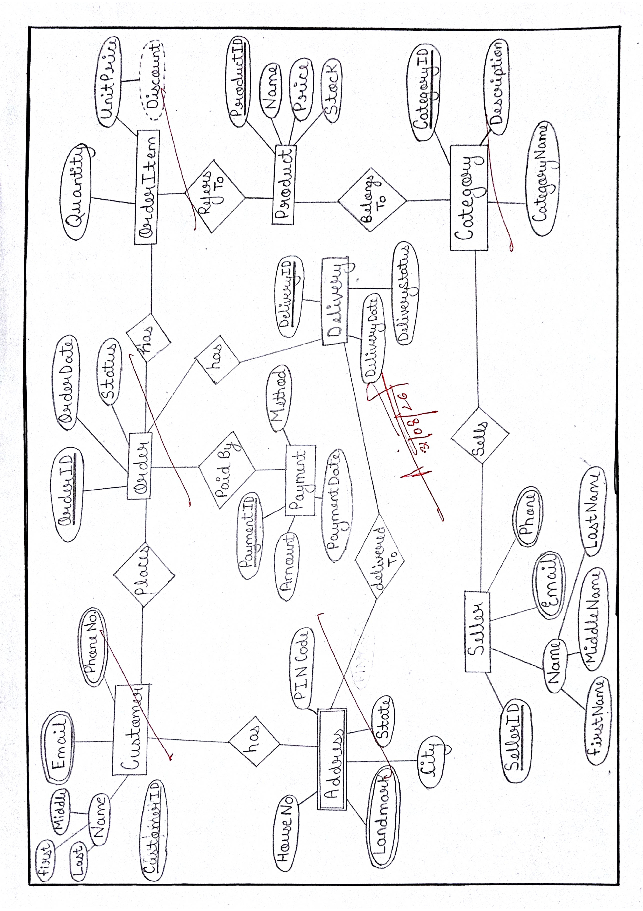

# Experiment 1: E-R Diagram of an E-Commerce Database System

## Aim

To draw an Entity-Relationship (ER) diagram for an E-Commerce Database System showing entities, attributes, keys, and different types of attributes.

## Description

This experiment contains the ER diagram of an E-Commerce Database System. It shows the main entities involved in an online shopping system, their attributes, and the special symbols used to represent different types of attributes and entities.

## Main Entities and Attributes

### 1. Customer
- `CustomerID` – Primary Key
- `Name` – Composite attribute, divided into First Name, Middle Name, and Last Name
- `Email` – Multivalued attribute
- `Phone No.` – Multivalued attribute

### 2. Order
- `OrderID` – Primary Key
- `OrderDate`
- `Status`

### 3. OrderItem
- `Quantity`
- `UnitPrice`
- `Discount` – Derived attribute, represented by a dashed oval and derived from UnitPrice

### 4. Product
- `ProductID` – Primary Key
- `Name`
- `Price`
- `Stock`

### 5. Category
- `CategoryID` – Primary Key
- `Description`
- `CategoryName`

### 6. Seller
- `SellerID` – Primary Key
- `Name` – Composite attribute, divided into First Name, Middle Name, and Last Name
- `Email` – Multivalued attribute
- `Phone No.` – Multivalued attribute

### 7. Payment
- `PaymentID` – Primary Key
- `Amount`
- `Method`
- `PaymentDate`

### 8. Address
Address is represented as a weak entity using a double rectangle.

- `House No.`
- `Pin Code`
- `Landmark` – Multivalued attribute
- `City`
- `State`

### 9. Delivery
- `DeliveryID` – Primary Key
- `DeliveryDate`
- `DeliveryStatus`

## Special Attributes and Symbols Used

- **Primary Key:** Uniquely identifies an entity.
- **Composite Attribute:** An attribute divided into smaller attributes, such as Name.
- **Multivalued Attribute:** Represented by a double oval, such as Email, Phone No., and Landmark.
- **Derived Attribute:** Represented by a dashed oval. Discount is shown as a derived attribute based on UnitPrice.
- **Weak Entity:** Represented by a double rectangle. Address is shown as a weak entity.

## ER Diagram

The following image shows the ER diagram drawn on an A4 sheet.

## Conclusion

The ER diagram represents the nine main entities of an E-Commerce Database System and their attributes. It shows primary keys, composite attributes, multivalued attributes, a derived attribute, and a weak entity. This diagram helps in understanding the database structure before creating the tables.
